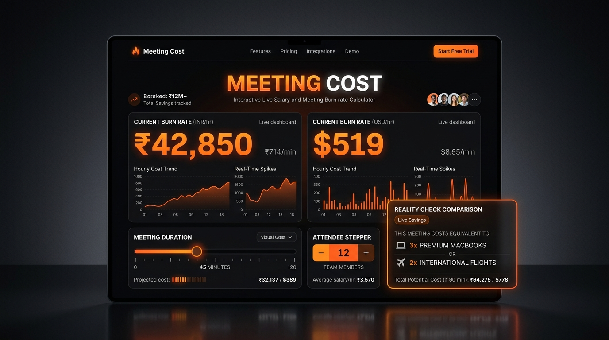

# 🔥 Meeting Cost — Live Salary & Meeting Burn Rate Calculator



> **"Time is money—literally."**  
> **Meeting Cost** transforms abstract calendar blocks and annual compensation packages into visceral, real-time financial telemetry.

---

## 🎯 Aim & Product Vision (Senior PM Perspective)

### The Problem
In modern knowledge work, calendar invites are free to send, which creates a tragedy of the commons for organizational time. A "quick 45-minute sync" with 8 engineers rarely feels like a financial transaction—yet in reality, it represents thousands of rupees or hundreds of dollars in direct payroll burn, not counting context-switching overhead. Because salaries are mentally anchored as annual (`LPA` / `$/yr`) or monthly figures, teams lack an intuitive, visceral sense of what **one hour** or **one minute** of collective attention actually costs.

### The Aim
The immediate aim of **Meeting Cost** is to provide zero-friction, instant financial transparency into the cost of work time and meetings. Without requiring sign-ups, spreadsheets, or submit buttons, any individual contributor, engineering manager, or executive can:
1. Translate an annual or monthly compensation figure (`₹ INR` or `$ USD`) into an exact **Hourly** and **Per-Minute** burn rate.
2. Simulate the true cost of a meeting across **1 to 25 attendees** and **15 to 480 minutes**.
3. Anchor abstract monetary numbers to tangible, everyday items ("15 plates of biryani", "a new AirPods", "a weekend trip to Goa") to trigger immediate behavioral reflection.

### The Long-Term Vision
Our vision is to evolve **Meeting Cost** from a standalone financial awareness calculator into an **Organizational Time-Capital Operating System**:
- **Phase 1 (Current — Awareness & Visceral Anchoring):** Instant salary-to-burn-rate translation, multi-attendee meeting simulation, real-time stopwatch ticker, and relatable purchasing-power comparisons.
- **Phase 2 (Calendar & Workspace Intelligence):** Browser extension and Google Calendar / Microsoft Outlook plugins that badge calendar invites with estimated burn rates *before* the organizer hits "Send".
- **Phase 3 (Meeting ROI & Async Nudges):** Automated post-meeting ROI pulse checks and "Could this have been an async doc?" nudges when recurring meetings exceed a threshold burn (e.g., ₹50,000/month or $1,000/month).

---

## ⚡ Unique Selling Proposition (USP)

Why does **Meeting Cost** stand out from generic hourly wage calculators or enterprise time-tracking tools?

1. **Zero-Latency Live Reactive Computation:** Every keystroke, currency toggle (`₹ INR` ↔ `$ USD`), pay-period switch (`Annual` ↔ `Monthly`), slider drag, and attendee stepper click updates the burn rate in `<16ms` with zero submit buttons or page reloads.
2. **Behavioral Economics "Reality Check" Engine:** Humans struggle to emotionally process raw payroll figures in the middle of a busy workday, but everyone understands the value of **15 plates of biryani 🍛**, **a pair of AirPods 🎧**, or **a weekend trip to Goa 🏖️**. Our dynamic comparison engine bridges the cognitive gap between corporate budgets and real-world purchasing power.
3. **India + Global Dual-Native Design:** Built ground-up with first-class support for Indian numbering conventions (`en-IN` formatting, `Lakhs` and `Crores` shorthand, LPA presets) alongside US Dollar (`en-US`, `$k`/`$M`) conventions.
4. **Customizable Work-Capacity Baseline:** While defaulting to the standard corporate baseline of **22 working days/month** and **8 hours/day** (`176 hrs/month` · `2,112 hrs/year`), users can dynamically tune their exact working schedule on the fly.
5. **Playful Yet Executive-Ready Dark UI:** High-contrast dark obsidian canvas with fiery orange accents (`#f97316`), tabular monospace numerals (`JetBrains Mono`) to prevent layout jitter during live ticking, and resilient, playful edge-case handling (*"Nah, that can't be the case"* for zero/negative inputs).

---

## 🛠️ Tech Stack & Architecture

| Layer | Technology | Rationale |
| :--- | :--- | :--- |
| **Frontend Framework** | **React 19** (`react`, `react-dom`) | Component-driven declarative UI with instant state reconciliation for zero-latency live calculations as the user types or drags sliders. |
| **Language & Type Safety** | **TypeScript 7** | Strict typing across currency modes, time-period conversions, and edge-case state machines. |
| **Build Tool & Bundler** | **Vite 8** | Sub-second cold starts and optimized production asset bundling. |
| **Styling System** | **Tailwind CSS v4** (`@tailwindcss/vite`) | Utility-first styling with custom fire-glow luminescence, dark-mode optical hierarchy, and responsive breakpoints from mobile (`375px`) to desktop (`1440px`). |
| **Animation & Micro-Interactions** | **Motion** (`motion/react` v12) | Smooth, hardware-accelerated transitions (`AnimatePresence`) between Empty, Invalid (`<= 0`), and Valid calculation states, plus collapsible configuration drawers. |
| **Iconography** | **Lucide React** | Crisp, consistent vector affordances for timers, steppers, schedule controls, and live tickers. |
| **Typography** | **Plus Jakarta Sans** & **JetBrains Mono** | Neo-grotesque geometric display headers paired with strict tabular monospace numerals (`tabular-nums`) for financial precision. |
| **Internationalization / Formatting** | **Native ECMAScript `Intl.NumberFormat`** | Zero-dependency locale-accurate formatting for `en-IN` (`₹15,00,000`) and `en-US` (`$110,000`). |

---

## ✨ Key Features Breakdown

### 1. Live Salary-to-Rate Engine (Version 1 Core)
- **Dual Toggles:** Seamlessly switch between `₹ INR` and `$ USD`, and toggle between `Annual` and `Monthly` compensation with automatic proportional conversion.
- **Editable Work Schedule Assumptions:** Adjust working days per month (`1–31`, default `22`) and working hours per day (`1–24`, default `8`) with live capacity readouts (`hrs/mo` and `hrs/yr`).
- **Smart Edge-Case Handling:**
  - *Empty Input:* Displays an inviting prompt to ignite the calculator.
  - *Zero or Negative Input:* Gracefully catches invalid numbers with *"Nah, that can't be the case"* and a one-click sample recovery button.

### 2. Multi-Attendee Meeting Cost Simulator (Version 2 Expansion)
- **Duration Slider (`15` to `480` mins):** Smoothly slide from a 15-minute standup to an 8-hour full-day offsite, complete with quick-select chips (`15m`, `30m`, `45m`, `1h`, `2h`, `4h`, `8h`).
- **Attendee Stepper (`1` to `25` people):** Increment/decrement attendees (default `5`) or pick team size presets (`1:1`, `Scrum 5`, `Team 10`, `Dept 15`, `Max 25`).
- **Relatable Purchasing Power Comparisons:** Automatically maps the total meeting burn to culturally relevant benchmarks in INR or USD, with an **Alternate** button to cycle through equivalent comparisons.
- **Live Meeting Stopwatch Burner:** Start a real-time second-by-second ticker during an actual meeting to watch the accumulated cost climb live.

---

## 🚀 Getting Started Locally

```bash
# 1. Install dependencies
npm install

# 2. Start the development server on port 3000
npm run dev

# 3. Type-check and build for production
npm run lint
npm run build
```

---

## 📦 Pushing to GitHub

This repository is initialized with Git and all application code, assets, and documentation are committed on the `main` branch.

To push to your remote GitHub repository:
1. **Using the AI Studio UI (Recommended):** Click the **GitHub / Export to GitHub** icon in the top toolbar of Google AI Studio to authenticate and push directly to a new or existing repository under your account.
2. **Using the CLI (if running locally or with a Personal Access Token):**
   ```bash
   git remote add origin https://github.com/<your-username>/meeting-cost.git
   git branch -M main
   git push -u origin main
   ```
